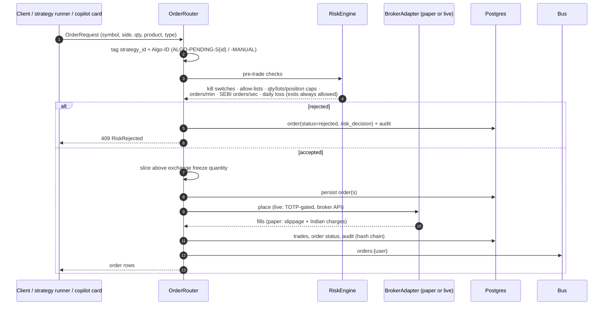
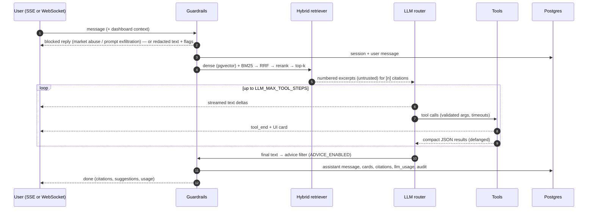

# Architecture

AlgoDesk is a monorepo with one FastAPI backend, a set of Python worker processes that share the same code and database
layer, and a Next.js frontend. Every Python process runs from the same Docker image; the command decides the role.

## System overview

```mermaid
flowchart LR
  subgraph Client
    B[Browser<br/>Next.js 15 · React 19<br/>TanStack Query · Zustand]
  end

  subgraph Edge
    W[web<br/>Next.js server<br/>proxies /api/*]
  end

  subgraph Backend
    API[api<br/>FastAPI · REST + SSE + WebSocket<br/>auth · risk checks · copilot]
    MD[market-data<br/>tick streamer<br/>Upstox V3 feed / mock]
    SR[strategy-runner<br/>live deployments<br/>paper matcher]
    WK[worker<br/>arq jobs: backtests · news ·<br/>screen alerts · RAG · privacy purge]
  end

  subgraph Data
    PG[(Postgres 16<br/>TimescaleDB · pgvector)]
    RD[(Redis<br/>pub/sub bus · KV · arq queue)]
  end

  subgraph External
    UP[Upstox API + WS feed]
    NSE[NSE MCP server]
    BR[10 broker APIs<br/>Upstox · Zerodha · Angel · Dhan · Fyers<br/>Kotak Neo · 5paisa · ICICI Breeze · Alice Blue · Shoonya]
    LLM[LLM providers<br/>GPT-6 Luna (OpenAI-compatible)<br/>Anthropic · Ollama]
    RZP[Razorpay]
    RSS[News RSS]
  end

  B -- HTTPS --> W -- /api/* --> API
  B -- WebSocket /ws --> API
  API <--> PG
  API <--> RD
  MD -- ticks:{symbol} --> RD
  SR <--> RD
  SR <--> PG
  WK <--> RD
  WK <--> PG
  MD <--> UP
  API --> NSE
  SR -- orders --> BR
  API -- manual orders --> BR
  API --> LLM
  WK --> LLM
  API <--> RZP
  WK --> RSS
```

With `EMBEDDED_WORKERS=true` (or no Redis), the API process hosts the tick streamer, the paper matcher, the strategy runner manager
and a small scheduler, and uses an in-memory bus/KV. That is how `make dev-lite`, the test suite, the evals and CI e2e run. Docker
Compose runs every role as its own container.

## Repository layout

| Path | What it is |
|---|---|
| `apps/web` | Next.js 15 app: Copilot, Build, Live, Analysis (12 dashboards), News, Portfolio, Profile, Admin. Playwright e2e in `e2e/`. |
| `apps/api` | FastAPI app (`app/routes/*`), WebSocket gateway, embedded runtime, Alembic migrations, seed data, API tests. |
| `packages/py-common` (`algo_common`) | Settings, logging, errors, bus, KV, rate limiting, AES-GCM vault, IST time utilities, Prometheus metrics, shared schemas. |
| `packages/db` (`algo_db`) | SQLAlchemy 2 models, session management, hash-chained audit log, DPDP purge. |
| `packages/api-client` | Typed TypeScript client generated from the OpenAPI schema. |
| `packages/ui` | Tailwind preset and shared UI helpers. |
| `services/market-data` | Market data providers (Upstox REST + protobuf WS feed, deterministic mock), NSE MCP client, instrument universe, option maths, news parsing. |
| `services/broker-gateway` | `BrokerAdapter` interface, 10 broker adapters + paper broker, order router, risk engine, kill switch, cost model, notifications. |
| `services/strategy-engine` | Strategy DSL, indicators, patterns, event-driven and vectorised backtesters, optimisation, walk-forward, Monte Carlo, live runner, analytics for the dashboards. |
| `services/ai-agent` | LLM gateway, RAG pipeline and corpus, agent tools, guardrails, the agent loop. |
| `services/jobs` | arq worker, job registry and cron schedule. |
| `evals/` | 131 copilot evaluation cases and the scoring harness. |
| `infra/` | Prometheus config and Docker helpers. |

## Data flows

### Market data

1. The WS gateway records which symbols connected clients want (`md:demand` set + per-symbol heartbeats in KV) and pings `md:control`.
2. The tick streamer (market-data service, or embedded) subscribes those symbols on the Upstox V3 market feed (protobuf) or the mock
   generator, and publishes normalised ticks to `ticks:{symbol}` on the bus.
3. The gateway fans ticks out to subscribed sockets; strategy runners consume the same channels to build bars.

REST quotes, candles and option chains go through the `MarketDataProvider` interface (`market_data.registry.get_provider()`):
the Upstox provider in `DATA_MODE=live`, the deterministic mock otherwise. Live provider errors surface as errors and are never
silently replaced with mock data.

### Order path



### Copilot turn



The router tries the primary provider (OpenAI-compatible "GPT-6 Luna" by default), then `LLM_FALLBACKS` (Anthropic, Ollama), then
the rule-based offline model. Failover happens only before any output was streamed, and a failed provider is skipped for 60 s.
Cheap/strong models are chosen per turn by a transparent heuristic.

### Backtests and deployments

* `POST /api/backtests` stores a `backtests` row and enqueues `run_backtest`. The job loads candles (DB cache, then provider), runs the
  CPU-bound engine in a thread, streams progress on `backtest:{id}` and stores metrics, curves and trades. The copilot's
  `run_backtest` tool uses the same path.
* `POST /api/deployments` snapshots the DSL version, validates broker/2FA/plan limits and publishes on `deploy:control`. The runner
  manager starts a `StrategyRunner` that turns ticks into bars, evaluates the DSL and sends orders through the `OrderRouter`.
  Pause/resume/stop/square-off and the kill switch go through the same control channel.

## Data model

All tables live in one Postgres database (`packages/db/algo_db/models`): users, sessions, user_2fa, consents; strategies,
strategy_versions, backtests, backtest_trades, deployments, deployment_logs; broker_connections (encrypted credentials), orders, trades,
positions_snapshots, risk_limits; instruments, candles (Timescale hypertable when available), option_chain_snapshots, news_items,
watchlists, screens, alerts, notifications; chat_sessions, chat_messages, rag_documents, rag_chunks (pgvector `vector(384)`),
llm_usage; plans, subscriptions, payments; audit_log, system_flags. Migrations: `apps/api/alembic` (CI checks up → down → up and
`alembic check`).

## Security architecture

* **Authentication.** Argon2 password hashes; short-lived JWT access tokens kept in memory by the SPA; opaque refresh tokens that rotate
  on every use, with family revocation on reuse, in an httpOnly cookie scoped to `/api/auth`; CSRF double-submit for cookie-authenticated
  endpoints; Google OAuth (authorization-code flow with a one-time `state`); TOTP 2FA with replay protection and recovery codes. 2FA is required for live trading, and
  every live order or deployment needs a fresh code.
* **Secrets.** Broker credentials and TOTP secrets are encrypted with AES-256-GCM (`algo_common.crypto.Vault`) using
  associated data bound to the owner (`user:{id}:broker:{name}`), so a ciphertext cannot be replayed into another account. They are
  never returned by the API, logged or exported. Keys come from `VAULT_MASTER_KEY` (`VAULT_KEY_ID`); rotate by adding the old key to `VAULT_PREVIOUS_KEYS` and calling `Vault.rotate()`.
* **Web.** Strict CSP, HSTS, frame-ancestors none, `X-Content-Type-Options`, referrer policy, CORS allow-list, per-IP rate limits,
  request IDs, input validation via Pydantic everywhere.
* **Audit.** `audit_log` is append-only and hash-chained (`hash = sha256(prev_hash ‖ canonical_json(entry))`); a Postgres trigger rejects
  UPDATE/DELETE and `GET /api/admin/audit/verify` recomputes the chain.
* **Strategy code sandbox.** User Python only runs for `CUSTOM` indicators and code-mode builders. It runs in a separate
  `python -I -B` process with an AST allow-list (no imports, dunders, I/O-capable attributes), a minimal builtins table, an empty
  environment, a throw-away working directory and `setrlimit` CPU/memory/file limits. **Production hardening:** run the worker and
  strategy-runner containers with `read_only: true`, `no-new-privileges`, all capabilities dropped, a seccomp profile (Docker's
  default or stricter), an AppArmor profile, and **no outbound network** except the broker egress proxy. The sandbox is defence in
  depth, not a substitute for kernel isolation.
* **AI.** Guardrails in code (not just prompts): PII/secret redaction before any provider call, untrusted-data wrapping and defanging of
  tool output, RAG chunks, news and dashboard context, market-abuse refusals, an advice filter, and audit entries for every turn. Tools are
  read-only, except `deploy_strategy`, which only prepares a confirmation card.

## Broker adapters & licensing

The brief asked to evaluate **OpenAlgo** (AGPL-3.0) for broker connectivity. Linking or vendoring AGPL code into a network service
would oblige us to offer the complete source of the whole platform to every user. That is a business decision the brief didn't
make, so:

* No OpenAlgo code is copied, vendored or imported. OpenAlgo was used only as a **reference for the brokers' public wire protocols**:
  endpoint paths, field names, product/order-type vocabularies, checksum schemes and symbol formats. These are facts about third-party
  APIs, documented by the brokers themselves.
* All ten adapters (`services/broker-gateway/broker_gateway/adapters/*`) are independent implementations behind our own
  `BrokerAdapter` interface. ICICI Breeze has no OpenAlgo module and follows ICICI's public Breeze documentation.
* If you prefer to run OpenAlgo itself as a separate service, the `BrokerAdapter` interface can wrap its REST API. Running it as a
  separate, unmodified AGPL service keeps the obligations scoped to that service; take legal advice for your situation.

## Static egress IP (SEBI / broker requirement)

SEBI's retail-algo framework requires API orders to originate from a static IP registered with the broker. The application does not
pick its own source IP, so configure this at the infrastructure layer:

1. Route outbound traffic from the `api` and `strategy-runner` containers through a **NAT gateway** (cloud) or an **egress proxy**
   (Squid/Envoy on a host with a reserved IP). On Kubernetes, use an egress gateway or a node pool behind a NAT with a reserved IP.
2. Restrict broker hostnames to that path with network policies; market-data and LLM traffic may use other routes.
3. Set `EGRESS_STATIC_IP` to the public address. The Profile → Brokers screen shows it to users so they can whitelist it in each
   broker's developer console, and `GET /api/risk/limits` reports it.
4. Monitor: a broker rejecting orders for "IP not whitelisted" means the route changed.

## Observability

* Structured JSON logs (structlog) with request IDs and user IDs; secrets are never logged (a structlog processor masks secret-looking fields).
* Prometheus metrics at `/metrics` (HTTP latency, orders by status, risk rejections, backtests, ticks, WS clients, kill-switch state, LLM
  tokens). Compose profile `observability` starts Prometheus and Jaeger.
* OpenTelemetry tracing of FastAPI requests when `OTEL_EXPORTER_OTLP_ENDPOINT` is set (add SQLAlchemy/httpx instrumentors the same way if you need deeper spans); Sentry when `SENTRY_DSN` is set.
* `GET /api/admin/health` checks the database, cache/bus, market data, NSE MCP, LLM providers, job queue and realtime gateway.

## Testing

| Layer | Tooling | Where |
|---|---|---|
| Python unit + integration | pytest, SQLite or Postgres (`TEST_DATABASE_URL`) | `*/tests` (113+ tests) |
| Frontend unit | Vitest + Testing Library | `apps/web/src/**/*.test.ts` |
| End-to-end | Playwright (desktop + mobile) | `apps/web/e2e` |
| Copilot | deterministic eval harness, CI gate `--min-score 0.85` | `evals/` |
| Migrations | Alembic up/down/up + `alembic check` on Postgres in CI | `.github/workflows/ci.yml` |

## Scaling notes

* API and runners are stateless apart from in-flight streams; scale horizontally behind a load balancer with sticky WebSockets, or
  rely on the Redis bus, which already fans out across instances.
* Strategy runners partition by deployment id; one runner process comfortably handles dozens of bar-driven deployments.
* Backtests are CPU-bound; scale the `worker` service. Intraday ranges are clipped to bound memory.
* Candles belong in a Timescale hypertable; add continuous aggregates for 1m→15m/1h when the dataset grows.
