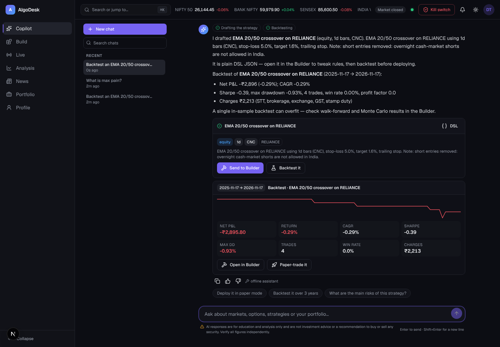
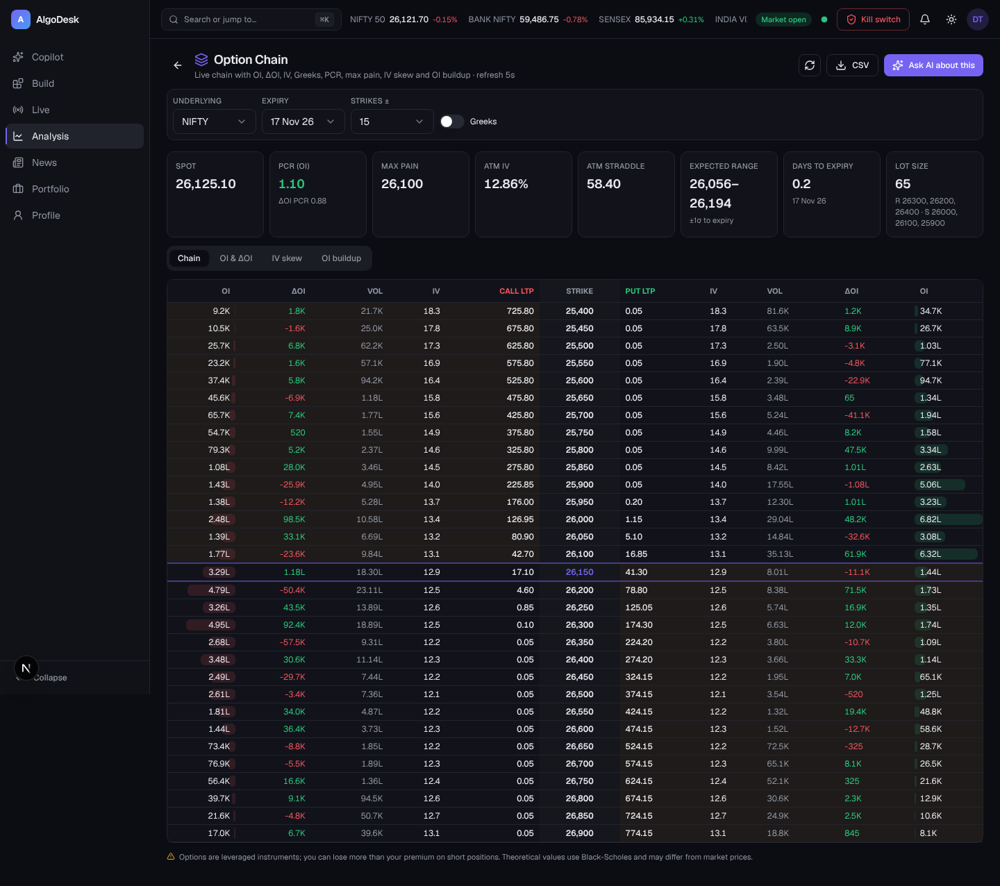
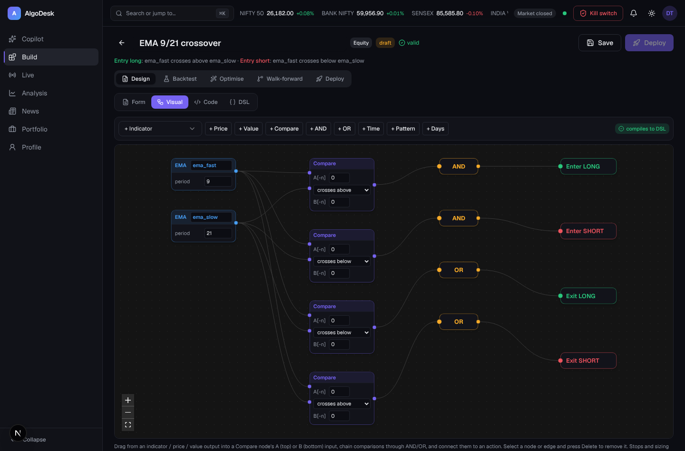
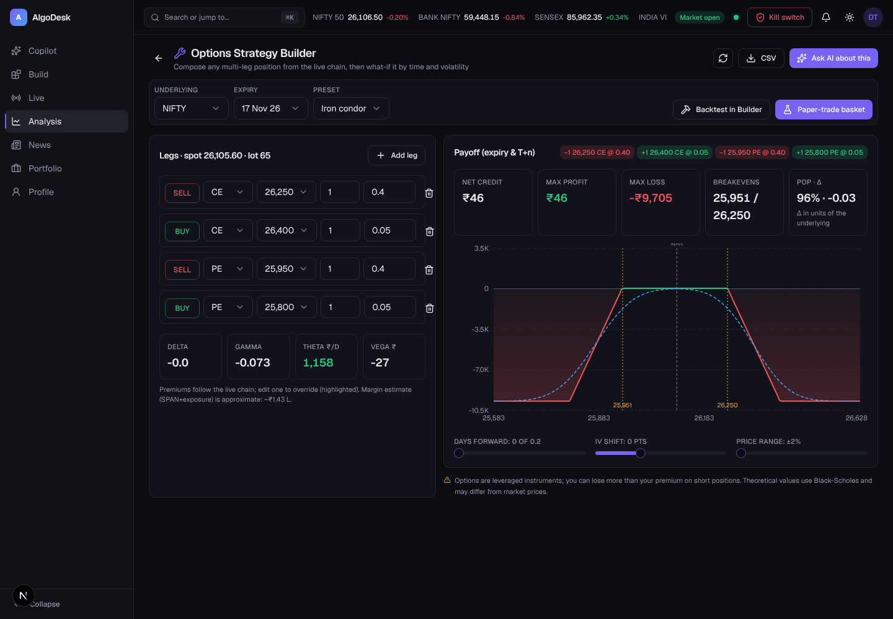
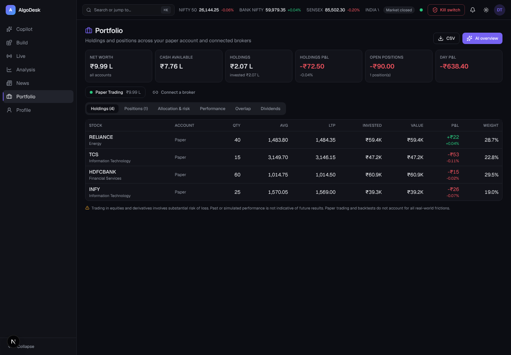

# AlgoDesk

**AI-first research and algorithmic trading platform for Indian markets**: NSE, BSE and MCX, across cash, futures and options.
Research with an AI copilot and 12 analysis dashboards, build strategies visually or as JSON, backtest them with Indian costs, paper-trade
on live prices, and deploy to ten brokers behind a pre-trade risk engine. Everything runs offline with deterministic mock data, so the
whole product works without any API keys.



| | |
|---|---|
|  |  |
|  |  |

## Features

**Copilot (home)** — streaming answers with live tools: quotes, charts and technicals, option chains (PCR, max pain, OI buildup),
payoffs and Greeks, fundamentals, news, all NSE MCP tools (FII/DII flows, corporate actions, results calendar, bulk/block deals,
shareholding), screeners and scanners, your portfolio, and strategy drafting (DSL JSON) → backtest → deploy. A deployment always
needs your confirmation in the UI. Answers include rich cards, cited knowledge-base sources, follow-up chips, and history with pin,
rename, search and share. Every dashboard has an **Ask AI about this** button that hands its context to the copilot.

**Build** — visual node editor, form editor, Monaco JSON editor with schema validation and code mode, all compiling to one
versioned [strategy DSL](docs/STRATEGY_DSL.md). Templates: EMA crossover, short straddle with SL, Bank Nifty iron condor, pair trade,
RSI mean reversion, Supertrend + ADX, opening range breakout.

**Backtesting** — event-driven and vectorised engines, intraday square-off, options legs priced with Black-Scholes, effective-dated
Indian charges (STT, exchange, SEBI, stamp duty, GST, brokerage), slippage, freeze-quantity slicing, metrics (CAGR, Sharpe, Sortino,
Calmar, drawdown, win rate, profit factor…), grid/random optimisation and walk-forward with overfitting warnings, and Monte Carlo.

**Live** — paper, live (2FA + step-up code) or notify-only deployments; per-deployment risk limits; logs, orders and P&L streaming;
pause, resume, square-off and stop; a paper-trading desk; a user kill switch and a platform kill switch.

**Brokers** — Upstox, Zerodha, Angel One, Dhan, Fyers, Kotak Neo, 5paisa, ICICI Breeze, Alice Blue and Shoonya, plus the default
paper broker. Credentials are AES-GCM encrypted. Every order passes the risk engine (kill switches, allow-lists, size and position
caps, orders/minute, the SEBI orders/second threshold, daily loss) and is tagged with an Algo-ID and written to a hash-chained audit log.

**Analysis** — Market overview, option chain, arbitrage scanner (cash-futures, calendar, NSE-BSE, put-call parity), ratio spreads,
straddle/strangle, butterfly & condor, options strategy builder with what-if sliders, technical, fundamental, quant (VaR, regimes,
correlations, seasonality), pairs (cointegration, z-score) and a stock screener with saved screens and alerts. All have filters, CSV
export and Ask AI.

**News · Portfolio · Profile · Admin** — news with AI summaries, sentiment and calendars; consolidated portfolio (holdings, allocation,
risk, XIRR, strategy overlap, dividends); profile with account/KYC placeholder, subscription (Razorpay test mode), notifications
(in-app, email, Telegram, WhatsApp), appearance (colour-blind palette), privacy (consents, export, DPDP deletion); and a role-gated
admin console (users, billing, knowledge-base manager, health, platform kill switch, audit viewer, black-box RA reviews).

## Quick start

### Docker (recommended)

```bash
cp .env.example .env
make dev            # postgres (timescale + pgvector), redis, migrate+seed, api, worker, market-data, strategy-runner, web
```

Open <http://localhost:3000> and click **Try the demo account**. API docs: <http://localhost:8000/docs>.

Optional profiles: `docker compose --profile ollama up` (local LLM), `--profile observability` (Prometheus + Jaeger).

### Without Docker (Windows, macOS, Linux)

Requires Python 3.12+ with [uv](https://docs.astral.sh/uv/) and Node 22 with pnpm 10. The same two commands work in
PowerShell, Command Prompt, VS Code's terminal and any Unix shell:

```bash
uv sync                              # Python dependencies (first time only)
uv run python scripts/dev.py         # installs JS deps on first run, seeds the DB, starts API (:8000) + web (:3000)
```

Open <http://localhost:3000> once it prints **AlgoDesk is running**, and press `Ctrl+C` to stop both servers. The launcher
uses a local SQLite database (`var/algo.db`) and in-process workers, so nothing else needs to be installed. Useful flags:
`--reset` (fresh demo data), `--env-db` (use `DATABASE_URL`/`REDIS_URL` from `.env`, e.g. Postgres), `--api-only`.
`make dev-lite` runs the same launcher.

If a page shows *Can't reach the AlgoDesk API*, the backend is not running (or crashed): check the launcher's terminal.

### Accounts (development only)

| Account | Login | Notes |
|---|---|---|
| Demo trader | **Try the demo account** button, or `demo@algodesk.in` / `demo12345` | Pro plan, seeded strategies and backtests |
| Admin | `admin@algodesk.in` / `admin12345` | Admin console. Not created when `ENVIRONMENT=production`. |

## Configuration

All settings are environment variables documented in [`.env.example`](.env.example). The ones you are most likely to set:

| Integration | Variables | Without it |
|---|---|---|
| **LLM: "GPT-6 Luna"** (any OpenAI-compatible endpoint) | `LLM_PRIMARY_PROVIDER=openai_compat`, `LLM_PRIMARY_MODEL=gpt-6-luna`, `LLM_PRIMARY_BASE_URL`, `LLM_PRIMARY_API_KEY`, optional `LLM_CHEAP_MODEL` / `LLM_STRONG_MODEL` | Built-in offline assistant (rule-based, tool-using, cites sources) |
| Fallback LLMs | `ANTHROPIC_API_KEY`; `OLLAMA_ENABLED=true` (+ `ollama` compose profile); `LLM_FALLBACKS` | — |
| Embeddings | `EMBEDDING_PROVIDER=hashing\|openai_compat\|ollama` | Deterministic hashing embedder |
| Market data | `DATA_MODE=live`, `UPSTOX_ANALYTICS_TOKEN` (or the OAuth app keys) | Deterministic mock market (history since 2019, live ticks, option chains) |
| NSE data | `NSE_MCP_URL` (+ transport/key) | Mock NSE tools with the same surface |
| Brokers | Users connect their own accounts in Profile → Brokers; register `EGRESS_STATIC_IP` with each broker | Paper broker |
| Payments | `RAZORPAY_KEY_ID`, `RAZORPAY_KEY_SECRET`, `RAZORPAY_WEBHOOK_SECRET` | Simulated checkout (non-production) |
| Notifications | `SMTP_*`, `TELEGRAM_BOT_TOKEN`, `WHATSAPP_WEBHOOK_URL` | In-app only |
| Compliance | `ADVICE_ENABLED` (keep `false` without SEBI IA/RA registration), `ALGO_ID_PREFIX`, `ORDER_RATE_LIMIT_PER_SEC` | Safe defaults |

## Development

```bash
make test           # pytest (SQLite) + vitest
make e2e            # Playwright smoke tests (desktop + mobile) against running servers
make evals          # copilot evals (131 cases); CI requires --min-score 0.85
make lint typecheck # ruff + eslint, mypy + tsc
make migrate        # alembic upgrade head      ·  make seed  ·  make gen-api  ·  make docs-api
make zip            # package the repository as algo-platform.zip
```

Run the Python suite against Postgres with `TEST_DATABASE_URL=postgresql+asyncpg://…`. CI (`.github/workflows/ci.yml`) runs lint, type
checks, migrations up/down/up with `alembic check`, pytest on SQLite and Postgres, the evals gate, vitest, a production build, Playwright,
secret scanning, dependency audits and Docker builds.

## Documentation

| Document | Contents |
|---|---|
| [ARCHITECTURE.md](ARCHITECTURE.md) | System diagram, services, data flows (orders, copilot), security, broker licensing (OpenAlgo/AGPL), static egress IP, observability |
| [COMPLIANCE.md](COMPLIANCE.md) | SEBI retail-algo framework mapping, investment advice, market abuse, DPDP Act, payments, record keeping, go-live checklist |
| [docs/API.md](docs/API.md) | Auth, conventions, SSE and WebSocket protocols, and every endpoint (generated from OpenAPI) |
| [docs/STRATEGY_DSL.md](docs/STRATEGY_DSL.md) | Strategy DSL reference with examples |
| [docs/RUNBOOK.md](docs/RUNBOOK.md) | Deployment, kill-switch procedure, key rotation, monitoring, backups, incident response |
| [DECISIONS.md](DECISIONS.md) | Every design decision and assumption made while building, with rationale |
| [evals/README.md](evals/README.md) | How the copilot is evaluated |
| [docs/AUDIT.md](docs/AUDIT.md) | Full product audit: what was tested, every defect found and how it was fixed |

## Repository layout

```
apps/web               Next.js 15 frontend (+ e2e/)
apps/api               FastAPI backend, WebSocket gateway, Alembic, seed, API tests
packages/py-common     shared settings, logging, bus/KV, crypto, time utils, metrics
packages/db            SQLAlchemy models, audit chain, DPDP purge
packages/api-client    generated TypeScript client
packages/ui            Tailwind preset + UI helpers
services/market-data   Upstox + mock providers, NSE MCP client, option maths, news parsing
services/broker-gateway  adapters for 10 brokers + paper, order router, risk engine, costs, kill switch
services/strategy-engine DSL, indicators, backtesters, live runner, dashboard analytics
services/ai-agent      LLM gateway, RAG, tools, guardrails, agent loop
services/jobs          arq worker and jobs (backtests, news, alerts, RAG, privacy)
evals/                 copilot eval cases + harness
infra/                 Prometheus config, Docker helpers
```

## Disclaimer

AlgoDesk is software for research, education and executing **your own** strategies through **your own** broker. It does not provide
investment advice. Trading in securities and derivatives involves substantial risk of loss; past or simulated performance does not
guarantee future results. Read [COMPLIANCE.md](COMPLIANCE.md) before operating the platform for other users.

No open-source license file is included; choose one before distributing. No AGPL code is included (see ARCHITECTURE.md → Broker
adapters & licensing).
